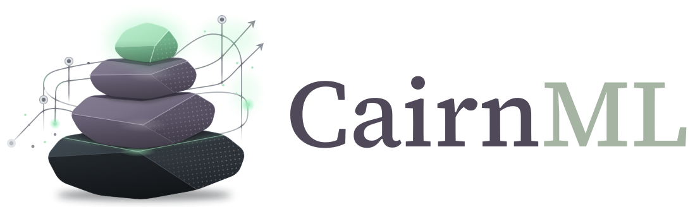

  <picture>
    <source media="(prefers-color-scheme: dark)" srcset="assets/cairnml-logo-dark.svg">
    <source media="(prefers-color-scheme: light)" srcset="assets/cairnml-logo.svg">
    
  </picture>

  

# CairnML Examples

## Goals

Learn what the CairnML platform does by running small, guided examples on your own server.

What you will learn:

- How to set up an account, the web app and the SDK, and the words CairnML uses (Example 0).
- How to track a run and train a real model (Examples 1 and 2).
- How to keep code private, give CairnML read access with a GitHub App, and run it on an agent (Examples 3 and 4).
- How datasets are versioned and read, in a registry or in a repository of your own (Examples 5 and 6).
- How to build workflows, search hyperparameters, record reports, manage the life of a task and import an outside run (Examples 7 to 11).

## Prerequisites

- A running [CairnML server](https://github.com/gianlucapargaetzi/cairnml-server) and Python 3.9 or newer.
- An account, the web app, the SDK and an enrolled machine: [Example 0](examples/00-installation-and-setup) guides you through all of it.
- A [GitHub](https://github.com) account for examples 3 to 6, and [git](https://git-scm.com). The GitHub command line `gh` is optional: every step that can use it also shows the way in the browser.

> [!CAUTION]
> The examples create real things on GitHub: private repositories, a GitHub App and commits. We do this only to get through the examples. Everything can be cleaned up afterwards: delete the repositories `cairnml-private-demo` and `greenhouse-data` on GitHub and in your folders, delete the GitHub App, and remove its credential under **Settings → Access** in the web app.

## Examples

Do them in order. Each one builds on the earlier ones.

| Example | What it shows |
|---|---|
| [0. Installation and setup](examples/00-installation-and-setup) | An account, the first sign-in, a tour of the web app, the terminology, the SDK and enrolling your machine |
| [1. Hello world](examples/01-hello-world) | One run with parameters, a metric curve and an artifact |
| [2. CIFAR-10 classification](examples/02-cifar10-classification) | Multiclass classification of small photographs, with curves and the trained model |
| [3. Private code and credentials](examples/03-private-code-and-credentials) | A private repository, a GitHub App, and the credential that lets CairnML read it |
| [4. Run on an agent](examples/04-run-on-an-agent) | Running the private code on an agent, from the command line and from the web app |
| [5. CIFAR-10 through the dataset registry](examples/05-cifar-10-managed-dataset) | The same training as example 2, reading the data through the dataset registry |
| [6. A regression dataset in its own repository](examples/06-regression-dataset) | Generating a dataset from a seed, publishing it as a private dataset repository, and reading it through the SDK |
| [7. A workflow of three steps](examples/07-workflow-pipeline) | Preparing data, training and evaluating as one pipeline, with each step as its own task |
| [8. Hyperparameter optimisation with Optuna](examples/08-hyperparameter-optimisation) | A search over learning rate, layer size and batch size, with the trials on a queue |
| [9. Reports and plots](examples/09-reports-and-plots) | Scatter plots, histograms, tables, confusion matrices and images next to the scalars |
| [10. The life of a task](examples/10-task-lifecycle) | Cloning, queueing, archiving, moving, publishing and deleting a task |
| [11. Import a run from a project that does not use CairnML](examples/11-import-external-run) | Adapting a legacy training folder to CairnML's import format and uploading it |

Examples 6 to 11 need the dataset repository that example 6 creates.

## Compare the runs

Examples 2 and 5 use the same model, settings and images. After both have run, open the **examples** project in the web app and compare the two tasks. Their validation accuracy curves should be close, and the configuration of the run of example 5 shows the dataset, its revision and the registry commit.

## Having problems

1. Check the [open issues](https://github.com/gianlucapargaetzi/cairnml-examples/issues).
2. If your problem is not listed, [open a new issue](https://github.com/gianlucapargaetzi/cairnml-examples/issues/new) with the example you ran, the command, and the full error message.
