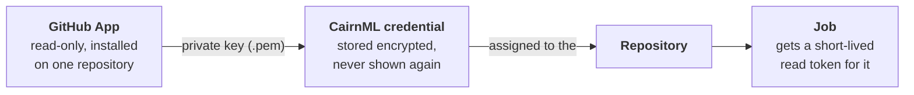

# Private code and credentials

## Goals

Put your training code in a private GitHub repository and give CairnML read access to it, so that an agent can run the code in [Example 4](../04-run-on-an-agent).

What you will learn:

- Why CairnML reads private code through a GitHub App, and not through your own login.
- How to create the App, install it on one repository only, and add it to CairnML as a credential.
- How a credential is assigned to a repository.

## Background

An agent is another machine. To run your code it has to clone the repository, and a private repository refuses anyone who is not allowed in. Handing the agent your own GitHub login would give it everything you can reach, for as long as you have an account.

A GitHub App is the narrower way. It is an identity of its own that you create on GitHub, with read-only access to code, and install on exactly the repositories it may read. You can remove it from a repository at any time. This is how the pieces connect:



You will make a private repository from the code of [Example 2](../02-cifar10-classification), create the App, add it to CairnML, and assign it to the repository. Nothing runs in this example.

## Prerequisites

- About 15 minutes.
- The [SDK connected to your server](../00-installation-and-setup), and [Example 1](../01-hello-world) run once, so the project **examples** exists.
- A GitHub account and [git](https://git-scm.com). The GitHub command line `gh` is optional: where a step uses it, the same step shows the browser way.

## Steps

### 1. Make the repository folder

From the root of the examples repository:

```bash
python examples/03-private-code-and-credentials/make_private_repo.py ../cairnml-private-demo
```

The script copies `train.py` and `requirements.txt` from Example 2 into a new folder outside this repository and makes the first commit. That folder is the repository you publish next. It needs only git.

The copied `train.py` is the code the agent runs in [Example 4](../04-run-on-an-agent). It already holds the two options for that: `--queue` names the queue, and `--image` chooses the container image of the job. That choice is made in the code, with `task.set_base_docker(docker_image=...)` before `task.execute_remotely(...)`, so it is recorded with the run and applies to every clone of it.

### 2. Publish it as a private repository

Both ways end with a private repository `cairnml-private-demo` under your account, holding the commit from step 1. The commands start from the root of the examples repository.

> [!CAUTION]
> This repository, its commits and the push exist only to get through the examples. When you are done you can delete `cairnml-private-demo` on GitHub and the folder next to this repository.

**With the GitHub command line** (log in once with `gh auth login`):

```bash
cd ../cairnml-private-demo
gh repo create cairnml-private-demo --private --source . --push
```

**In the browser:**

1. Open [github.com/new](https://github.com/new), enter the name `cairnml-private-demo` and choose **Private**.
2. Leave **Add a README**, **.gitignore** and **license** off, because the folder already has its files. Click **Create repository**.
3. In the folder, push to the address GitHub shows. Git asks you to sign in: use your system's credential helper, or the SSH address if you have an SSH key on GitHub.

```bash
cd ../cairnml-private-demo
git remote add origin https://github.com/<your-user>/cairnml-private-demo.git
git push -u origin main
```

Check: open the repository in a private browser window where you are not signed in. GitHub shows *404 Not Found*, which is what CairnML sees until you finish this example.

### 3. Create the GitHub App

This is done on GitHub, in the browser.

1. Open **User → Settings → Developer settings → GitHub Apps → New GitHub App**. For an organisation, use the same page under the organisation's settings.
2. Fill in:
   - **GitHub App name:** for example `cairnml-<your-name>`. It must be unique on GitHub.
   - **Homepage URL:** any address, for example the address of your repository.
   - **Webhook:** switch **Active** off. CairnML needs none.
   - **Repository permissions → Contents:** **Read-only**. Leave everything else at **No access**.
   - **Where can this GitHub App be installed?** **Only on this account**.
3. Click **Create GitHub App**. Note the **App ID** at the top of the page.
4. Under **Credentials → Key pairs**, click **"New key"**. Your browser saves a `.pem` file. It is the secret half of the App: keep it, and do not commit it.

### 4. Install the App on the repository, and only on it

1. On the App's page open **Install App** and choose your account.
2. Choose **Only select repositories**, pick `cairnml-private-demo` and click **Install**.

A repository that is not selected stays unreadable, even for CairnML.

### 5. Add the App to CairnML

1. In the CairnML web app open **Settings → Access** and click **Add credential**.
2. Enter a **Name**, for example `my github app`, and the **App ID**. Leave **API address** empty for github.com.
3. Choose the `.pem` file and click **Add credential**.

CairnML checks the key with GitHub before it saves anything. If you are an admin, the dialog also asks who may use the credential: choose **Only me**.

Check: the credential is listed with a working status. In the terminal, `cairnml credential list` shows it too, in the environment from Example 0: run `source .venv/bin/activate` in the root of the repository first.

### 6. Add the repository and assign the credential

The App is installed on the repository, but CairnML does not yet know which credential to read it with. That is the assignment.

1. Open **Repositories & Datasets** and click **Add repository or dataset**.
2. Choose the type **Code**, enter `https://github.com/<your-user>/cairnml-private-demo`, choose the project **examples**, and choose your credential (or assign it in the next steps). Click **Add**.
3. The new row has a red closed lock in the **Access** column while no credential is assigned: CairnML cannot read a private repository without one. Open its row and, in the **Credentials** table of the side panel, click the lock button **Assign credentials** (the **Project** column already lists `examples`).
4. Choose your credential and click **Set credential**.

CairnML asks GitHub for a read token for the repository with your App. This only works if the App is installed on it, so a credential that cannot read the repository is refused with the reason.

Check: the **Access** lock is now green and open, and the **Credentials** table has one row with your credential, you as **Owner**, the project `examples` and the green lock. **Check now** (the refresh button of the row) confirms it again.

What else the page shows: every record has a short **ID**; **Added by** names who listed it; **Visibility** shows one person (not shared: only you and the projects that use it see it) or several (shared by the admin with every user). The credential is yours: it is assigned to you, not to the project, so other users' rows in the table are read-only, and only you can change or delete yours. A repository that a project lists cannot be deleted (its trash button is disabled and says why): take it out of the project first.

In the terminal: `cairnml repository add https://github.com/<your-user>/cairnml-private-demo --type code --project <project-id> --credential <credential-id>`, then `cairnml repository list` shows how each repository is read. The same list is under **project settings → Repositories** of the project.

## Troubleshooting

- **`the GitHub App … is not installed on …`:** step 4 is missing, or the App is installed on another account.
- **`You have no credentials to choose from`:** step 5 is missing.
- **The key is refused:** the App ID and the `.pem` belong to different Apps, or the App is on a GitHub Enterprise server (fill in **API address**).
- **There is no lock button:** the lock assigns *your own* credential, so it is on your row of the Credentials table only. Other users' rows are read-only.

## Next steps

Continue with [Example 4: run on an agent](../04-run-on-an-agent).
