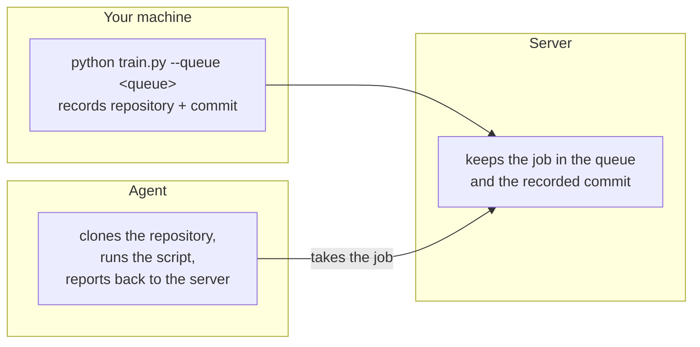

# Run on an agent

## Goals

Run the code of your private repository on an agent, first from the command line and then from the web app.

What you will learn:

- How an agent takes work from a queue.
- How the same script runs either on your machine or on an agent.
- How to clone a task and enqueue it in the web app, without the command line.

## Background

Training often belongs on a machine other than your laptop, one with a GPU or that stays on. An **agent** is such a machine. You send it work through a **queue**, and it reports everything back to your server, so a run on an agent looks like a local one.



The agent runs the **commit the run recorded**, not what is on your disk, so the code must be pushed. It clones the private repository with the credential from [Example 3](../03-private-code-and-credentials). The agent holds no Git credentials of its own: for each job the server gives it a short-lived read token for that repository, made with the credential of the project's owner (you), or with yours when you run in somebody else's project.

## Prerequisites

- About 10 minutes, plus the training time.
- [Example 3](../03-private-code-and-credentials) done: the repository `cairnml-private-demo` is pushed and is readable with your credential in **Repositories & Datasets**.
- The [SDK connected to your server](../00-installation-and-setup).
- A machine with Docker for the agent. It can be your own.

## Steps

### 1. Start an agent

On the machine that will run the jobs, in the environment from Example 0. If that is another machine, create the environment there as in Example 0:

```bash
source .venv/bin/activate
pip install cairnml-agent
cairnml-agent init http://<server-ip>
cairnml-agent daemon --docker
```

In every new terminal on that machine, go to the repository root and run `source .venv/bin/activate` again before using `cairnml-agent`.

`init` opens the sign-in page. Sign in with your own account. `daemon` must keep running. `--docker` runs every job in its own container. Add `--gpus 0` to use the first GPU.

Enrolling also made a queue for this machine, and `daemon` without `--queue` serves it. An agent serves only its own queue, so jobs for this agent go there. The queue is named after the machine **plus a short suffix**, for example `parg-nb-b59488` for the machine `parg-nb`. `init` prints it (`queue of this machine: ...`) and **Agents & Queues → Queues** lists it. Note that exact name as `<queue>` for the next steps: the bare machine name does not work. The agent's own key is in `~/.cairnml/agent/`, apart from the SDK's.

Check: the machine appears under **Agents & Queues** in the web app.

> [!TIP]
> Run `daemon` in its own terminal and leave it open, so you can watch its output while you queue runs.

### 2. Start a run from the command line

From the root of the examples repository, on your own machine:

```bash
source .venv/bin/activate
cd ../cairnml-private-demo
pip install -r requirements.txt
python train.py --epochs 3 --queue <queue>   # for example --queue parg-nb-b59488
```

In a new terminal, go to the root of the examples repository and run `source .venv/bin/activate` first. `--queue <queue>` is the only difference from a local run. The command queues the run and ends:

```
Switching to remote execution, output log page http://<server-ip>/cairnml/...
CairnML Terminating local execution process - continuing execution remotely
```

If you change the code, commit and push before you run again.

**The container image.** The agent runs every job in a container. Without a choice it uses its own default image, which you can see under **Execution → Container** on the task. To run the job in another image, add `--image`:

```bash
python train.py --epochs 3 --queue <queue> --image python:3.12-slim
```

`train.py` passes it on before it queues the run:

```python
task.set_base_docker(docker_image=args.image)    # the image of the job; arguments and a setup script can be set here too
task.execute_remotely(queue_name=args.queue)
```

The image is stored on the task, so clones of it use the same image. The agent installs itself and the SDK into the image, so the image needs Python 3.9 or newer. An image the agent does not have yet is pulled first.

> [!CAUTION]
> Committing and pushing is needed here only because the agent runs a recorded commit. Every commit you push to `cairnml-private-demo` is part of the example and goes away when you delete the repository.

### 3. Watch the run

> [!NOTE]
> The agent runs every job in a container (`--docker`), so a run on an agent takes longer than a local one. The first time an agent is used, the base image has to be pulled and the environment installed in it, which can take several minutes before the first line of training output. Later runs reuse the image and the caches and start faster.

Under **Agents & Queues** the job waits in the agent's queue until the agent takes it, then shows on the agent's machine, in the row of the agent under **Agents** together with its progress. In the project **examples** the task **CIFAR-10 classification** goes from **Queued** to **Running** to **Completed**. While it runs, it has the same progress bar as a local run, with the epochs and the batches of the current epoch in the task. On the task:

- **Execution** shows the repository `cairnml-private-demo` and the commit it ran from.
- **Console** starts with the clone of the private repository, then the training output.
- **Scalars** and **Artifacts** hold the curves and the trained model, as in Example 2.

### 4. Run it again from the web app

A task can be copied and started with other settings without touching your machine.

1. Open the task and click **Clone**. In the **Clone Task** dialog keep the project **examples** and click **Clone**. The copy has the status **Draft**.
2. Open the copy and change `epochs` to `5` under **Configuration**. The image is under **Execution → Container**, and can be changed there too.
3. Click **Enqueue**, choose the queue of your agent and confirm.

The copy runs like the first one, from the same repository and commit, with your new settings. Because the commit is kept, a clone is also how you rerun exactly the same code later.

### 5. See what a missing credential does (optional)

1. In **Repositories & Datasets**, open the row of `cairnml-private-demo` and, in its **Credentials** table, delete your own row (the trash button), or run `cairnml repository unassign https://github.com/<your-user>/cairnml-private-demo`. The **Access** lock turns red and closed.
2. Clone the task and enqueue it. The web app stops you with **Credentials not assigned**: the repository is private and no credential reaches it.
3. Click **Assign credentials**, choose your credential and click **Set credential**. The enqueue then goes on by itself: the task is queued and runs.

## Troubleshooting

- **`Could not find queue named "..."`:** the name is not the exact name of a queue. The message lists the queues you can use and the closest one. An agent's queue is its machine name plus a suffix. The task is shown as **Failed**, with that message as the reason, and is not queued.
- **`requires a different Python` while the job starts:** the image has a Python older than 3.9. Use an image with a newer Python, with `--image`.
- **The task stays Queued:** no agent serves that queue. An agent serves only the queue that was made for it when it was enrolled, so use that name under **Agents & Queues → Queues**, and check that `daemon` is still running.
- **The task fails at the start with a repository error:** the credential is missing, or the App is no longer installed on the repository. Check the status in **Repositories & Datasets** and the message of the failed task.
- **The agent cannot find the commit:** it was not pushed. Run `git push`, then run again.
- **`unrecognized arguments: --queue`:** the folder was made from an older `train.py`. Make it again with Example 3.

## Next steps

Continue with [Example 5: CIFAR-10 through the dataset registry](../05-cifar-10-managed-dataset).
