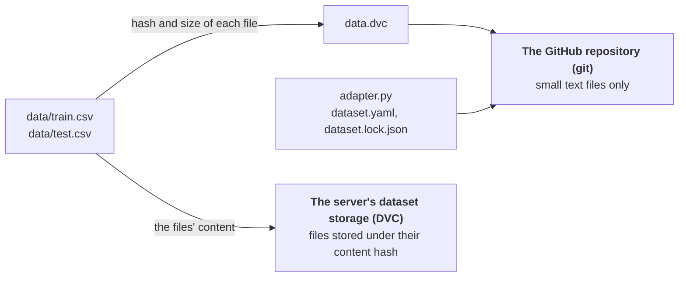

# A regression dataset in its own repository

## Goals

Keep a dataset as a versioned, private repository, and read one exact version of it in training code.

What you will learn:

- Where the data of a dataset lives, and what git tracks (DVC).
- How a run records exactly which data it read.
- How the server reads a private dataset repository with your credential.

## Background

The data is a made-up but realistic problem. A small greenhouse heats itself, and given the weather and the time of day the model should predict the energy it needs in kWh per hour. A script generates the data from a seed, so everyone gets the same files and nothing is downloaded.

**How a dataset is stored.** Git is good at code and poor at data: large files bloat the repository, and every clone downloads all of them. A dataset repository therefore splits the work with **DVC** (data version control):



- **Git holds only small text files.** The important one is `data.dvc`, which lists every file of `data/` with its content hash. The CSV files themselves are not in git.
- **DVC holds the files**, in the dataset storage of your server, under their content hash. A short-lived key from the server grants access, so nothing secret is stored on your machine.
- **A commit therefore names exact data.** The hashes in `data.dvc` fix the files, so checking out a commit and fetching its files gives the same data every time. Old commits keep their files, so an earlier version stays readable.
- **`push` uploads the files before it publishes the commit**, so a commit on GitHub never points at files that are missing.

When a run calls `Dataset.get(repository, commit)`, it records the repository, the commit and the content hash. That is all that is needed to see, and repeat, what the run trained on.

The data is read through `adapter.py`, a small adapter in the repository that turns the CSV files into the standard sample format. `dataset.lock.json` records that the data passed this check, so a CI check can verify a commit without downloading any data.

This is the right tool for data you own and must be able to reproduce. For public data you do not own, the registry in [Example 5](../05-cifar-10-managed-dataset) is the lighter choice.

## Prerequisites

- About 20 minutes.
- Python 3.9 or newer and [git](https://git-scm.com).
- The [SDK connected to your server](../00-installation-and-setup).
- The GitHub App credential from [Example 3](../03-private-code-and-credentials), listed under **Settings → Access**.
- The App installed on the new `greenhouse-data` repository (step 4). If it is not installed yet, nothing can be pushed or read.
- The GitHub command line `gh` is optional: where a step uses it, the same step shows the browser way.

## Steps

### 1. Install the tools

From the root of the repository:

```bash
source .venv/bin/activate
cd examples/06-regression-dataset
pip install -r requirements.txt
cairnml dataset --help
```

In every new terminal, go to the repository root and run `source .venv/bin/activate` again.

The last command lists the dataset commands, among them `init`, `remote`, `add`, `commit`, `push` and `doctor`.

### 2. Generate the data

`generate.py` draws five input columns and one target, `energy`. The file `params.yaml` holds the seed and the sizes: the same seed always gives the same data.

| Column | Meaning | Effect on energy |
|---|---|---|
| `outside_temp` | outside temperature in °C | colder means more heating |
| `light` | sunlight in kilo-lux | more light means less heating |
| `humidity` | relative humidity in % | very dry or very humid air costs extra |
| `co2` | carbon dioxide in ppm | none: it is noise, and a good model learns to ignore it |
| `hour` | hour of the day, 0 to 23 | nights cost more |

Use a temporary folder for everything below. `WORK` and the environment belong to one terminal. In a new terminal, go to the repository root, run `source .venv/bin/activate` and `cd examples/06-regression-dataset`, and set `WORK` again:

```bash
WORK=$(mktemp -d)
python generate.py "$WORK/greenhouse-export"
cp adapter.py "$WORK/greenhouse-export/"
```

This writes `train.csv` (2,000 rows) and `test.csv` (500 rows). The repository itself is the sibling folder `$WORK/greenhouse-data`, which the next step creates.

### 3. Set up the dataset locally

```bash
cairnml dataset init --path "$WORK/greenhouse-data" --adapter local
cp "$WORK/greenhouse-export/train.csv" "$WORK/greenhouse-export/test.csv" "$WORK/greenhouse-data/data/"
cp "$WORK/greenhouse-export/adapter.py" "$WORK/greenhouse-data/"
```

`init` makes a git repository and records that `adapter.py` at its top reads `data/`. It reaches neither GitHub nor the server.

### 4. Create the private repository and install the App on it

Create an empty private repository `greenhouse-data` on GitHub.

With the GitHub command line:

```bash
gh repo create greenhouse-data --private
```

Or in the browser: open [github.com/new](https://github.com/new), enter the name, choose **Private**, leave **README**, **.gitignore** and **license** off, and click **Create repository**.

Then give your App from Example 3 access to it. The server reads a repository only if the App is installed on it, and pushing the dataset also needs the App to be allowed to **write**: its permissions must be **Contents: Read and write** and **Workflows: Read and write** (Example 3, step 3). If your App is read-only, edit it under **Permissions & events** and accept the new permissions on the installation, or the push in step 5 is refused. On GitHub open **Settings → Applications → Installed GitHub Apps**, click **Configure** next to your App, and under **Repository access** add `greenhouse-data` to the selected repositories.

> [!CAUTION]
> The repository, the commits and the pushes of this example exist only to get through the examples. You can delete `greenhouse-data` on GitHub afterwards, and the folders under `$WORK`.

### 5. Connect, commit and push

Find the id of your credential:

```bash
cairnml credential list
```

Connect the dataset to the repository:

```bash
cairnml dataset remote add https://github.com/<your-user>/greenhouse-data.git --credential <credential-id> --path "$WORK/greenhouse-data"
```

`remote add` sets the repository as `origin`, sets up the dataset storage on your server, and registers the dataset with the credential, which the server then uses to read it. It checks that the repository is reachable with that credential and warns if not: then step 4 is incomplete. Without `--credential` the repository is listed with no credential: that works for a public repository (a green open lock), and a private one shows a red closed lock until you assign yours. The storage is DVC on your server by default; `--lfs` keeps the files in GitHub LFS instead, and the choice cannot be changed later.

Now record, check, commit and push:

```bash
cairnml dataset add --path "$WORK/greenhouse-data"
cairnml dataset commit --path "$WORK/greenhouse-data" -m "Add dataset"
cairnml dataset push --path "$WORK/greenhouse-data"
```

- `add` records `data/` with DVC. It needs the storage, so `remote add` comes first.
- `commit` runs the adapter, checks every sample against the dataset format, and commits the result with its footprint.
- `push` uploads the files to the storage, then publishes the commit.

> [!NOTE]
> `cairnml dataset create` does all of this in one call and creates the repository for you. The commands are separate here so that each step is visible.

After the first push, protect the default branch so that changes come in as pull requests: `cairnml dataset doctor --path "$WORK/greenhouse-data"` shows what is missing.

### 6. See what git holds and what it does not

```bash
git -C "$WORK/greenhouse-data" show --stat HEAD
```

The commit has `adapter.py`, `dataset.yaml`, `dataset.lock.json`, `manifest.json`, `data.dvc`, `.gitignore` and the verify workflow. The CSV files are not there: `.gitignore` excludes `data/`, and `data.dvc` holds their hashes. Look inside:

```bash
cat "$WORK/greenhouse-data/data.dvc"
```

Note the repository and the commit, which identify this version:

```bash
REPO=$(git -C "$WORK/greenhouse-data" remote get-url origin)
COMMIT=$(git -C "$WORK/greenhouse-data" rev-parse HEAD)
echo "$REPO $COMMIT"
```

Keep them: the next examples take them as parameters. You can delete `$WORK` afterwards; the data stays in the repository and the dataset storage.

> [!IMPORTANT]
> `REPO` and `COMMIT` live only in this terminal, and Examples 7 to 11 need both. Write them down now. If you lose them, the URL is the one of your repository and the commit is at the top of its commit list on GitHub.

In the web app, the **Repositories & Datasets** page now lists `greenhouse-data` with the type **Dataset**, your name under **Added by**, the one-person **Visibility** icon and a green open **Access** lock. The side panel shows the repository and the first characters of the commit. If the lock is red, the App is not installed on the repository (step 4).

### 7. Read the dataset in training code

```bash
python read_dataset.py "$REPO" "$COMMIT"
```

`Dataset.get` downloads the version into your cache once and records the repository, the commit and the content hash on the run. Pass a commit, not a branch, so the same data can be read later. The script then reads each sample back through the adapter and logs the number of rows and the mean and standard deviation of each column.

In the project **examples**, the task **greenhouse dataset read** shows the repository, the commit, the content hash (the one in `data.dvc`) and the storage in its configuration.

### Changing the dataset later

A new version is a new commit. Change the files in `data/`, then run `add`, `commit -m "message"` and `push`. `push` sends the files and opens a pull request into the protected default branch. Pass the new commit to the next examples to use the new version, while the old commit keeps its data.

## Data

Generated by `generate.py` from the seed in `params.yaml`. It is not based on real measurements and has no license restrictions.

## Next steps

Continue with [Example 7: a workflow of three steps](../07-workflow-pipeline). It and the following examples need the repository URL and the commit from this example.
